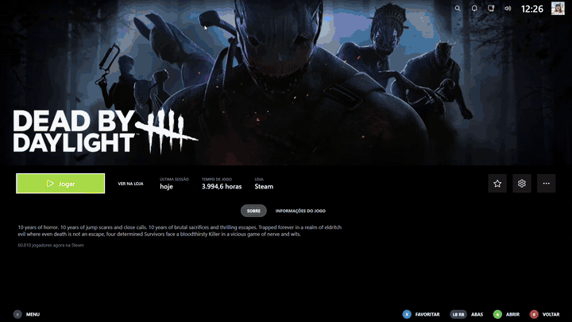

<p align="center">
  
</p>

<h1 align="center">DeckLauncher</h1>

<p align="center">
  Launcher de jogos para Windows com o visual do modo Big Picture, feito para controle, teclado e mouse.<br>
  Reúne seus jogos da <b>Steam</b> e da <b>Epic</b>, jogos <b>adicionados manualmente</b> e baixa capas, fundos e logotipos sozinho.
</p>

<p align="center">
  <a href="https://github.com/dupreys/DeckLauncher/actions/workflows/build.yml"></a>
  <a href="https://github.com/dupreys/DeckLauncher/releases/latest"></a>
  
  
  
  
</p>

---

## Demonstração

<p align="center">
  
</p>

## Funções

### Início e biblioteca
- **Início:** linha de jogos recentes (até 20). Só o último jogo jogado aparece num cartão largo, com o fundo e o logotipo; os outros ficam em capa estreita. O fundo da tela muda conforme o jogo em foco e o papel de parede se move devagar. O jogo em foco ganha um brilho de luz por baixo, e sob ele aparecem o nome e o tempo jogado nas últimas duas semanas (ou **JOGANDO AGORA** enquanto o jogo está aberto).
- **Estilos da tela inicial** (Configurações → Interface): **Clássico** (o padrão, descrito acima), **Painel** (jogo em destaque, grade com os recentes e atalhos com informações: biblioteca, downloads, amigos online...), **Sala (OLED)**, **Cinema** (título grande do jogo em foco com a arte ao fundo) e **Carrossel** (capa grande no centro) (fundo preto, relógio grande, ícones arredondados dos jogos e atalhos). A mudança vale na hora. Nos estilos Painel e Sala, Novidades/Recomendados abrem pelo atalho **Amigos** e pelo menu; a opção de apertar para baixo na linha vale no Clássico.
- **Personalização** (Configurações → Interface): cor de destaque (6 cores), tamanho dos cards da biblioteca (pequeno, médio, grande) e relógio/saudação grandes.
- **Contas Steam:** com mais de uma conta Steam no PC, o launcher pergunta qual usar ao abrir (ou entra direto na última/numa fixa, em Configurações → Integrações) e mostra só os jogos instalados dessa conta. Clique na sua foto no topo para trocar de conta. O launcher não faz login na Steam: para jogar com outra conta, a Steam precisa estar logada nela.
- **Dicas e avisos:** o rodapé mostra o que cada botão faz no item em foco; avisos rápidos de bateria baixa e de download concluído.
- **Novidades, Amigos e Recomendados:** apertando **para baixo** na linha de jogos (ou escolhendo a aba abaixo dos cards). Mostra anúncios dos seus jogos da Steam, jogos atualizados neste PC, quem dos seus amigos está jogando agora, a atividade deles (o que jogaram nas últimas duas semanas) e o calendário de lançamentos. Só lê dados públicos da Steam com a sua chave de API; o launcher não faz login na sua conta nem envia mensagens.
- **Biblioteca:** abas Todos / Steam / Epic / Adicionados / Favoritos / Aplicativos, busca por nome e grade de capas centralizada.
- **Não instalados:** a aba lista os jogos da sua conta Steam que ainda não estão instalados; na página do jogo, **Instalar** pede à Steam para baixar (o progresso aparece em Downloads) e **Ver na loja** abre a página dele no cliente da Steam.
- **Aplicativos:** atalhos com o ícone e o nome de Discord, Explorador de Arquivos, Microsoft Edge, Microsoft Store, Configurações e, se estiverem instalados, AMD Adrenalin e NVIDIA App; você também pode adicionar qualquer programa (.exe ou atalho) pelo botão + e remover com X.
- **Mais controle nos aplicativos:** adicione também links de sites (YouTube, Netflix, Twitch…) com o favicon do site, mude a ordem dos cartões e oculte os que não usa (X ou botão direito do mouse sobre o cartão).
- **Amigos online:** na aba AMIGOS da tela inicial, os amigos que estão online aparecem com o status; escolher um deles abre a conversa no cliente oficial da Steam (o launcher não faz login nem envia mensagens).
- **Atualizações:** ao abrir, o launcher avisa se há uma versão nova no GitHub; em Configurações > Sistema > Atualizações você verifica na hora e abre a página de download.
- **Página do jogo:** logotipo sobre o banner, botão **Jogar**, última sessão, tempo de jogo, loja, favorito, descrição, informações e quantos jogadores estão na Steam agora.
- **Renomear e esconder:** botão "..." na página do jogo. Os jogos escondidos voltam em Configurações > Jogos.
- **Gerenciar arte:** escolha à mão capas, fundos, logotipos e capturas de tela, ou restaure o padrão.
- **Arte automática:** capas, fundos e logotipos são baixados sozinhos (Steam, SteamGridDB, Wallhaven) e ficam em cache.

### Lojas e jogos
- **Steam, Epic e jogos adicionados:** os jogos instalados aparecem sozinhos; jogos de fora das lojas entram pelo arquivo `.exe`.
- **Lojas:** abre a página inicial da loja da Steam ou o Epic Games Launcher.
- **Downloads:** acompanha os downloads da Steam em tempo real (progresso, velocidade e tempo restante).
- **Tempo de jogo:** o launcher percebe quando um jogo está aberto, mesmo iniciado por fora, e conta a sessão minuto a minuto. Epic e jogos adicionados também ganham tempo total na página do jogo.
- **Entrando no jogo:** ao tocar em Jogar aparece uma tela com a arte e o logotipo do jogo, "Iniciando…" e um controle animado. Depois o jogo abre por cima.
- **Menu durante o jogo:** segure **Select + B por 2 segundos** para abrir o menu do launcher por cima do jogo. O jogo continua aberto em segundo plano e mudo; no menu lateral aparece o jogo atual com **Voltar ao jogo** e **Encerrar jogo**.

### Mídias
- Mostra as capturas do Game Bar do Windows (pasta `Vídeos\Captures`) em miniaturas. Fotos e vídeos abrem dentro do launcher, só para visualizar.

### Sistema
- **Configurações:** Sistema (tela cheia, efeitos sonoros, usar o mouse, iniciar com o Windows, atualizar a biblioteca, limpar o cache), Interface, Integrações e Jogos.
- **Interface:** **Preto OLED** (toda a interface em preto, em vez do azul escuro).
- **Perfil:** a foto no canto superior direito abre um painel para trocar a foto (qualquer imagem do PC ou a da Steam) e o nome mostrado no launcher; a conta da Steam não é alterada.
- **Rede e som:** painéis na barra superior com as conexões ativas (Wi-Fi/Ethernet) e o volume do Windows.
- **Ligar/Desligar:** suspender, desligar, reiniciar, finalizar sessão, minimizar e sair.
- **Iniciar com o Windows:** opção em Configurações > Sistema.

### Controle
- Navegação por direcional e analógico (Xbox, PlayStation, Switch e controles genéricos), dicas de botões (A/B) que trocam sozinhas e teclado virtual do Windows nos campos de texto.
- Por padrão o cursor do mouse fica escondido e o launcher só responde ao controle e ao teclado (dá para reativar o mouse em Configurações).
- Animações e sons de interface, que podem ser desligados.

## Download

1. Baixe o instalador `DeckLauncher-Setup-<versão>.exe` em [**Releases**](https://github.com/dupreys/DeckLauncher/releases/latest).
2. Abra o arquivo e siga o assistente de instalação (dá para criar um atalho na área de trabalho).
3. Ao terminar, abra o **DeckLauncher** pelo atalho ou pelo menu Iniciar.

### Modo Xbox (Experiência de Tela Cheia)

No assistente há a opção **Modo Xbox**, marcada por padrão: ela instala uma pequena "ponte" que deixa o DeckLauncher aparecer em **Configurações > Jogos > Experiência de tela cheia** do Windows 11, ao lado do Xbox. Escolha o **DeckLauncher (Modo Xbox)** nessa lista para usá-lo como tela inicial do console. Ao instalar, o Windows pede permissão de administrador (ela confia no certificado do pacote e pode ligar o Modo de desenvolvedor só durante a instalação). Para tirar, desinstale o DeckLauncher ou desmarque a opção. Dentro do Modo Xbox o launcher abre em tela cheia e grava `%AppData%\DeckLauncher\xbox-mode.log` para ajudar a achar problemas de foco com jogos.

Requisitos: Windows 10 ou 11. Steam e/ou Epic Games instalados (opcional: dá para usar só jogos adicionados).

## Configuração

Tudo é opcional, e as chaves ficam só no seu PC, criptografadas pelo Windows (DPAPI). Os dados do programa ficam em `%AppData%\DeckLauncher`.

| O quê | Para quê | Onde pegar |
|---|---|---|
| Chave do **SteamGridDB** | Capas, fundos, logotipos e capturas para jogos da Epic e manuais, e a escolha manual de arte | [steamgriddb.com/profile/preferences/api](https://www.steamgriddb.com/profile/preferences/api) |
| Chave da **API Web da Steam** | Aba Amigos (quem está jogando e a atividade) e "Populares entre amigos" | [steamcommunity.com/dev/apikey](https://steamcommunity.com/dev/apikey) |

Coloque as chaves em **Configurações > Integrações**. Para a aba Amigos, o seu perfil e a sua lista de amigos precisam estar públicos na Steam.

## Controles

| Controle | Teclado | Ação |
|---|---|---|
| Direcional / analógico | Setas | Navegar |
| A | Enter | Selecionar |
| B | Esc | Voltar |
| Select | F1 | Menu lateral (Ligar/Desligar é o último item) |
| Select + B (segurar 2 s) | — | Abre o menu do launcher por cima de um jogo aberto |
| LB / RB | — | Trocar de aba |
| Y | — | Buscar jogos (abre o teclado do Windows) |
| X | — | Favoritar o jogo em foco |
| — | F5 | Atualizar a biblioteca |
| — | F11 | Alternar janela e tela cheia |

Na tela inicial, **para baixo** na linha de jogos abre Novidades, Amigos e Recomendados.

## Estrutura do projeto

```
src/
  DeckLauncher.Core/     lógica sem interface: Steam, Epic, jogos manuais, arte, configurações
  DeckLauncher.App/      aplicativo WPF (telas, tema, controle, animações e sons)
tests/
  DeckLauncher.Core.Tests/   testes xunit da lógica
src/DeckLauncher.Fse/    ponte do Modo Xbox (programa .NET Framework 4.8 que abre o DeckLauncher)
fse/                     pacote do Modo Xbox (manifesto, capacidade, imagens e script que monta e assina o .msix)
installer/               script do instalador (Inno Setup) e scripts do Modo Xbox
.github/workflows/       build e release automáticos (GitHub Actions)
assets/                  ícone (SVG, PNG, .ico) e imagem de pré-visualização
docs/demo.gif            vídeo curto (GIF) usado neste README
```

## Limitações conhecidas

- A atividade dos amigos mostra o que eles jogaram nas últimas 2 semanas; a Steam não oferece o feed completo por API pública.
- O calendário de lançamentos mostra lançamentos populares da Steam, não a sua lista de desejos.
- O tempo de jogo recente só conta enquanto o launcher está aberto.
- O tempo de jogo de Epic e jogos adicionados é medido pelo launcher (contado a partir desta versão, sem histórico anterior); jogos que abrem outro programa para rodar, como um launcher próprio, podem não ser detectados.

## Créditos e avisos

- Arte de capas, fundos e logotipos: comunidade do [SteamGridDB](https://www.steamgriddb.com). Papéis de parede: [Wallhaven](https://wallhaven.cc), pertencentes aos seus autores. Cada imagem pertence ao seu criador ou à publicadora do jogo.
- Desenvolvido com a ajuda do [Claude](https://claude.ai), da Anthropic (programação e revisão do código).
- Projeto independente: **não é afiliado nem endossado** pela Valve, pela Steam, pela Epic Games, pelo SteamGridDB ou pelo Wallhaven. Steam e Epic Games são marcas dos seus donos.
- O visual é apenas inspirado no layout do modo Big Picture; nenhuma marca, logotipo ou arte da Valve é usada. O ícone do DeckLauncher é original.

## Licença

[MIT](LICENSE)
