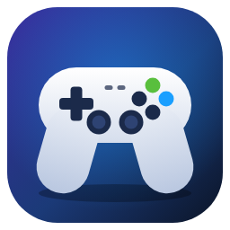
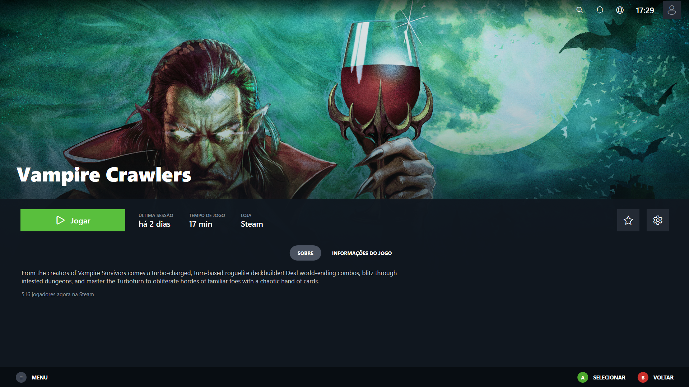
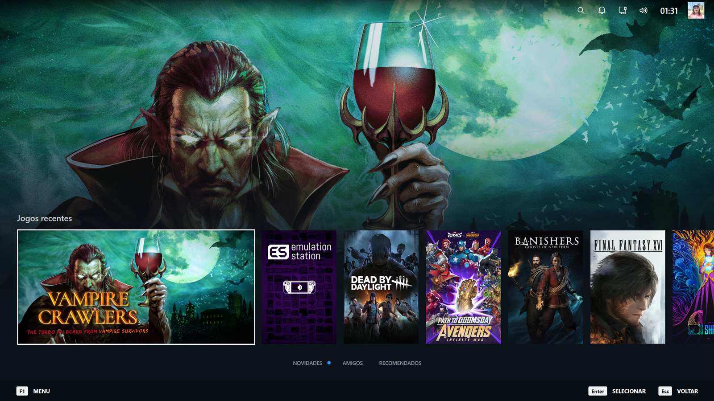
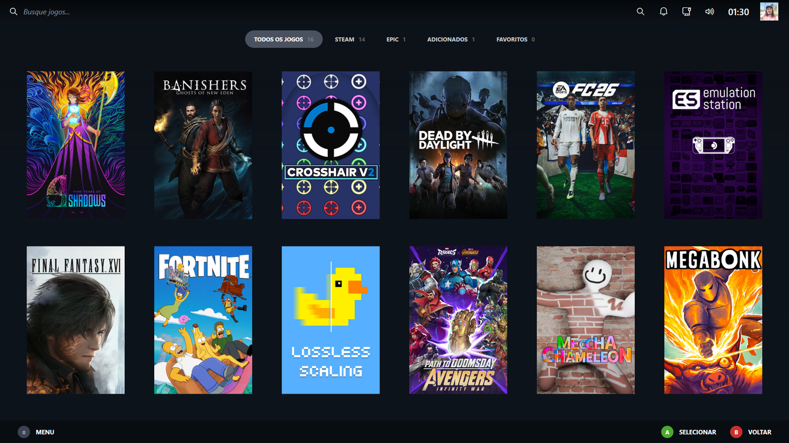
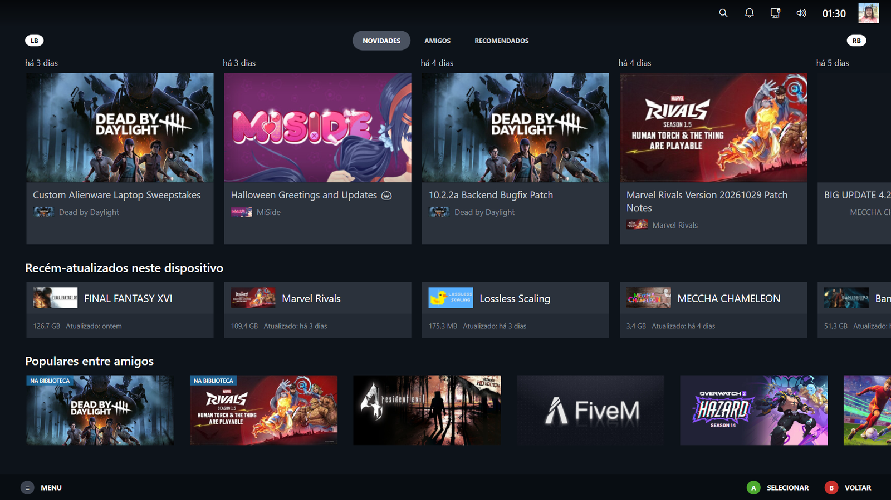
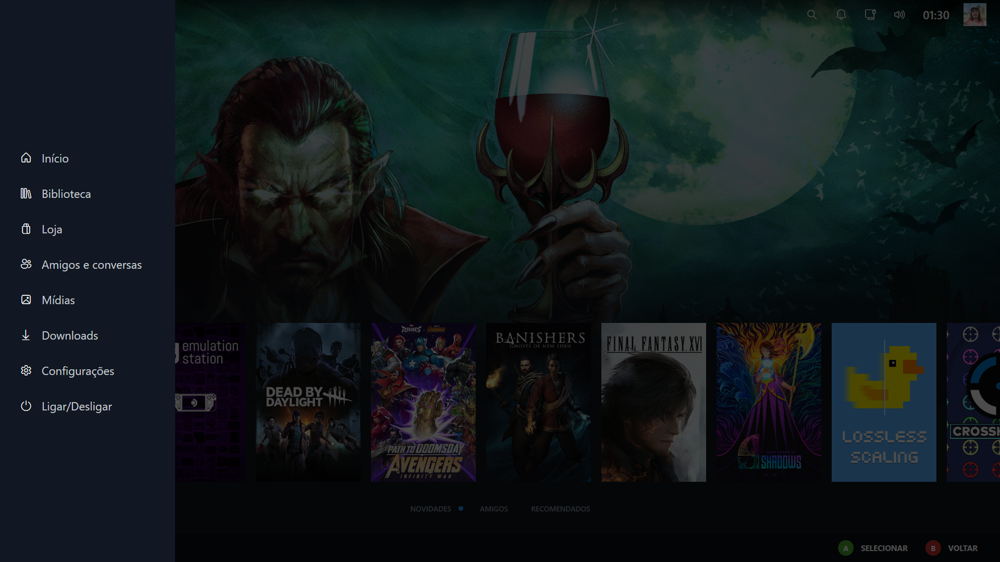

<p align="center">
  
</p>

<h1 align="center">DeckLauncher</h1>

<p align="center">
  Launcher de jogos para Windows com o visual do modo Big Picture, feito para controle, teclado e mouse.<br>
  Reúne seus jogos da <b>Steam</b> e da <b>Epic</b>, jogos <b>adicionados manualmente</b> e baixa capas, fundos e logotipos sozinho.
</p>

<p align="center">
  <a href="https://github.com/SEU-USUARIO/DeckLauncher/actions/workflows/build.yml"></a>
  <a href="https://github.com/SEU-USUARIO/DeckLauncher/releases/latest"></a>
  
  
  
  
</p>

---

## Prints

<p align="center">
  
</p>

<p align="center">
  
  
</p>
<p align="center">
  
  
</p>

## Recursos

- **Início:** linha de jogos recentes (até 20); só o último jogo jogado aparece num cartão largo, com o fundo e o logotipo; os outros ficam em capa estreita. Ao passar de um jogo para o outro, o cartão dá um pequeno zoom, brilha e recebe um reflexo de luz, e o fundo da tela muda conforme o jogo em foco.
- **Biblioteca:** abas Todos / Steam / Epic / Adicionados / Favoritos, busca e grade de capas centralizada.
- **Página do jogo:** logotipo sobre o banner, botão **Jogar**, última sessão, tempo de jogo (Steam), favorito, descrição e informações.
- **Novidades, Amigos e Recomendados:** anúncios dos seus jogos da Steam, jogos atualizados neste PC, quem está jogando agora, atividade dos amigos e calendário de lançamentos.
- **Arte automática:** capas, fundos e logotipos são baixados sozinhos (Steam, SteamGridDB, Wallhaven) e ficam em cache.
- **Gerenciar arte:** escolha à mão capas, fundos, logotipos e capturas de tela; restaure o padrão quando quiser.
- **Integrações:** Steam (jogos instalados, tempo de jogo, downloads, amigos) e Epic Games Store; jogos fora das lojas entram pelo arquivo `.exe`.
- **Downloads:** progresso dos downloads da Steam.
- **Rede e som:** painéis na barra superior com as conexões ativas (Wi-Fi/Ethernet) e o volume do Windows.
- **Tempo de jogo também fora da Steam:** o launcher percebe quando um jogo da Epic ou adicionado está aberto (mesmo iniciado por fora) e soma o tempo na página do jogo.
- **Renomear e esconder jogos:** botão "..." na página do jogo; os escondidos voltam em Configurações > Jogos.
- **Iniciar com o Windows:** opção em Configurações > Sistema.
- **Entrando no jogo:** ao tocar em Jogar aparece uma tela com a arte e o logotipo do jogo, "Iniciando…" e um controle animado com os botões sendo apertados. Depois o jogo abre por cima.
- **Menu durante o jogo:** segure **Select + B por 2 segundos** para abrir o menu do launcher por cima do jogo. O jogo continua aberto em segundo plano e **mudo**; no menu lateral, acima de Início, aparece o jogo atual com **Voltar ao jogo** e **Encerrar jogo**.
- **Só controle:** o cursor do mouse fica escondido e o launcher ignora o mouse (dá para reativar em Configurações > Sistema > Usar o mouse).
- **Perfil:** a foto no canto superior direito abre um painel para trocar a foto (qualquer imagem do PC ou a da Steam) e o nome mostrado no launcher; a conta da Steam não é alterada.
- **Ligar/Desligar:** suspender, desligar, reiniciar, finalizar sessão, minimizar e sair.
- **Controle de verdade:** XInput com navegação por direcional/analógico, dicas de botões (A/B) que trocam sozinhas, teclado virtual do Windows na busca.
- **Animações e sons** de interface (podem ser desligados em Configurações).

## Download

Baixe o `.zip` mais recente em [**Releases**](https://github.com/SEU-USUARIO/DeckLauncher/releases/latest), extraia e abra o `DeckLauncher.exe`:

- `DeckLauncher-<versão>-win-x64.zip`: autônomo, **não precisa instalar nada**.
- `DeckLauncher-<versão>-win-x64-requer-dotnet8.zip`: menor, mas precisa do [.NET 8 Desktop Runtime](https://dotnet.microsoft.com/download/dotnet/8.0).

Cada release traz o `SHA256SUMS.txt` para conferir os arquivos. Se o Windows SmartScreen avisar, é porque o programa ainda não é assinado digitalmente: clique em "Mais informações" > "Executar assim mesmo".

## Requisitos

- Windows 10 ou 11
- [.NET 8 SDK](https://dotnet.microsoft.com/download/dotnet/8.0) (para compilar) ou o .NET 8 Desktop Runtime (para só executar)
- Steam e/ou Epic Games instalados (opcional: dá para usar só jogos manuais)

## Como rodar

```powershell
git clone https://github.com/SEU-USUARIO/DeckLauncher.git
cd DeckLauncher
dotnet run --project src/DeckLauncher.App
```

Ou abra `DeckLauncher.sln` no Visual Studio 2022 e aperte **F5**.

### Gerar um executável

```powershell
dotnet publish src/DeckLauncher.App -c Release -r win-x64 --self-contained false -p:PublishSingleFile=true -o publish
```

O programa fica em `publish/DeckLauncher.exe`.

### Testes

```powershell
dotnet test
```

### Publicar uma versão (GitHub Actions)

O repositório já vem com dois fluxos em `.github/workflows/`:

- **Build:** compila e roda os testes a cada push na `main` e a cada pull request.
- **Release:** ao enviar uma tag `v*`, gera os dois `.zip`, os checksums e cria a release com as notas automáticas.

```powershell
git tag v0.11.0
git push origin v0.11.0
```

## Configuração

Tudo é opcional, e as chaves ficam só no seu PC, criptografadas pelo Windows (DPAPI). Os dados do programa ficam em `%AppData%\DeckLauncher`.

| O quê | Para quê | Onde pegar |
|---|---|---|
| Chave do **SteamGridDB** | Capas, fundos, logotipos e capturas para jogos da Epic e manuais, e a escolha manual de arte | [steamgriddb.com/profile/preferences/api](https://www.steamgriddb.com/profile/preferences/api) |
| Chave da **API Web da Steam** | Aba Amigos (quem está jogando e a atividade) e "Populares entre amigos" | [steamcommunity.com/dev/apikey](https://steamcommunity.com/dev/apikey) |

Coloque as chaves em **Configurações > Integrações**. Para a aba Amigos, o seu perfil e a sua lista de amigos precisam estar públicos na Steam.

## Controles

| Controle | Teclado | Ação |
|---|---|---|
| Direcional / analógico | Setas | Navegar |
| A | Enter | Selecionar |
| B | Esc | Voltar |
| Select | F1 | Menu lateral (Ligar/Desligar é o último item) |
| Select + B (segurar 2 s) | — | Abre o menu do launcher por cima de um jogo aberto |
| LB / RB | — | Trocar de aba |
| Y | — | Buscar jogos (abre o teclado do Windows) |
| X | — | Favoritar o jogo em foco |
| — | F5 | Atualizar a biblioteca |
| — | F11 | Alternar janela e tela cheia |

Na tela inicial, **para baixo** na linha de jogos abre Novidades, Amigos e Recomendados.

## Estrutura do projeto

```
src/
  LiteLauncher.Core/     lógica sem interface: Steam, Epic, jogos manuais, arte, configurações
  DeckLauncher.App/      aplicativo WPF (telas, tema, controle, animações e sons)
tests/
  LiteLauncher.Core.Tests/   testes xunit da lógica
.github/workflows/       build e release automáticos (GitHub Actions)
assets/                  ícone (SVG, PNG, .ico) e imagem de pré-visualização
docs/screenshots/        prints usados neste README
```

## Limitações conhecidas

- A atividade dos amigos mostra o que eles jogaram nas últimas 2 semanas; a Steam não oferece o feed completo por API pública.
- O calendário de lançamentos mostra lançamentos populares da Steam, não a sua lista de desejos.
- O tempo de jogo de Epic e jogos adicionados é medido pelo launcher (contado a partir desta versão, sem histórico anterior); jogos que abrem outro programa para rodar, como um launcher próprio, podem não ser detectados.

## Créditos e avisos

- Arte de capas, fundos e logotipos: comunidade do [SteamGridDB](https://www.steamgriddb.com). Papéis de parede: [Wallhaven](https://wallhaven.cc), pertencentes aos seus autores. Cada imagem pertence ao seu criador ou à publicadora do jogo.
- Projeto independente: **não é afiliado nem endossado** pela Valve, pela Steam, pela Epic Games, pelo SteamGridDB ou pelo Wallhaven. Steam e Epic Games são marcas dos seus donos.
- O visual é apenas inspirado no layout do modo Big Picture; nenhuma marca, logotipo ou arte da Valve é usada. O ícone do DeckLauncher é original.

## Licença

[MIT](LICENSE)
