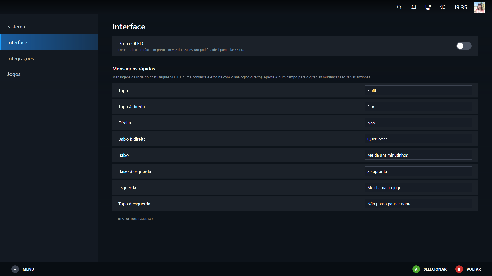
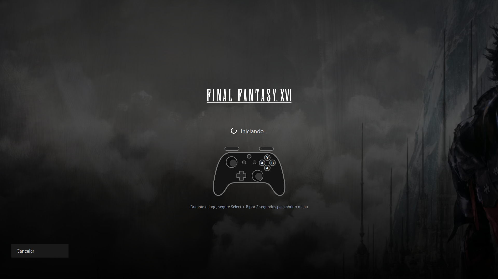
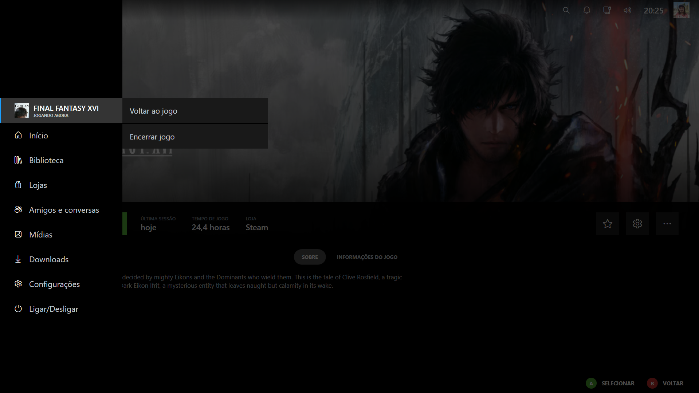

<p align="center">
  
</p>

<h1 align="center">DeckLauncher</h1>

<p align="center">
  Launcher de jogos para Windows com o visual do modo Big Picture, feito para controle, teclado e mouse.<br>
  Reúne seus jogos da <b>Steam</b> e da <b>Epic</b>, jogos <b>adicionados manualmente</b> e baixa capas, fundos e logotipos sozinho.
</p>

<p align="center">
  <a href="https://github.com/dupreys/DeckLauncher/actions/workflows/build.yml"></a>
  <a href="https://github.com/dupreys/DeckLauncher/releases/latest"></a>
  
  
  
  
</p>

\---

## Prints

<p align="center">
  
  
</p>
<p align="center">
  
  
</p>
<p align="center">
   Interface" width="430">
  
</p>
<p align="center">
  
</p>

## Funções

### Início e biblioteca

* **Início:** linha de jogos recentes (até 20). Só o último jogo jogado aparece num cartão largo, com o fundo e o logotipo; os outros ficam em capa estreita. O fundo da tela muda conforme o jogo em foco e o papel de parede se move devagar. O jogo em foco ganha um brilho de luz por baixo, e sob ele aparecem o nome e o tempo jogado nas últimas duas semanas (ou **JOGANDO AGORA** enquanto o jogo está aberto).
* **Novidades, Amigos e Recomendados:** apertando **para baixo** na linha de jogos. Mostra anúncios dos seus jogos da Steam, jogos atualizados neste PC, quem está jogando agora, atividade dos amigos e o calendário de lançamentos.
* **Biblioteca:** abas Todos / Steam / Epic / Adicionados / Favoritos, busca por nome e grade de capas centralizada.
* **Página do jogo:** logotipo sobre o banner, botão **Jogar**, última sessão, tempo de jogo, loja, favorito, descrição, informações e quantos jogadores estão na Steam agora.
* **Renomear e esconder:** botão "..." na página do jogo. Os jogos escondidos voltam em Configurações > Jogos.
* **Gerenciar arte:** escolha à mão capas, fundos, logotipos e capturas de tela, ou restaure o padrão.
* **Arte automática:** capas, fundos e logotipos são baixados sozinhos (Steam, SteamGridDB, Wallhaven) e ficam em cache.

### Lojas e jogos

* **Steam, Epic e jogos adicionados:** os jogos instalados aparecem sozinhos; jogos de fora das lojas entram pelo arquivo `.exe`.
* **Lojas:** abre a página inicial da loja da Steam ou o Epic Games Launcher.
* **Downloads:** acompanha os downloads da Steam em tempo real (progresso, velocidade e tempo restante).
* **Tempo de jogo:** o launcher percebe quando um jogo está aberto, mesmo iniciado por fora, e conta a sessão minuto a minuto. Epic e jogos adicionados também ganham tempo total na página do jogo.
* **Entrando no jogo:** ao tocar em Jogar aparece uma tela com a arte e o logotipo do jogo, "Iniciando…" e um controle animado. Depois o jogo abre por cima.
* **Menu durante o jogo:** segure **Select + B por 2 segundos** para abrir o menu do launcher por cima do jogo. O jogo continua aberto em segundo plano e mudo; no menu lateral aparece o jogo atual com **Voltar ao jogo** e **Encerrar jogo**.

### Amigos e conversas

* **Lista de amigos:** no menu lateral. Mostra os amigos on-line (com o jogo ou o status) e os off-line, com a última vez que ficaram on-line. Precisa da chave da API Web da Steam.
* **Chat pelo launcher:** escolha um amigo e a conversa abre ao lado. Na primeira vez, aprove o código QR no app da Steam do celular (Steam Guard > Entrar com código QR). O launcher guarda só o nome da conta e um token da Steam, criptografados; a senha nunca passa por ele. As mensagens dos amigos chegam na hora. Enquanto a página Amigos está aberta, o launcher aparece como uma sessão on-line da sua conta. Em Configurações > Integrações, **Sair do chat** apaga o token.
* **Abrir no Steam:** abre a mesma conversa no app da Steam.
* **Mensagens rápidas:** numa conversa, **segure SELECT**, escolha com o **analógico direito** e aperte **A** para enviar; soltar o SELECT fecha a roda. Um toque rápido no SELECT continua abrindo o menu lateral. As 8 mensagens são editáveis em Configurações > Interface.

### Mídias

* Mostra as capturas do Game Bar do Windows (pasta `Vídeos\\\\\\\\Captures`) em miniaturas. Fotos e vídeos abrem dentro do launcher, só para visualizar.

### Sistema

* **Configurações:** Sistema (tela cheia, efeitos sonoros, usar o mouse, iniciar com o Windows, atualizar a biblioteca, limpar o cache), Interface, Integrações e Jogos.
* **Interface:** **Preto OLED** (toda a interface em preto, em vez do azul escuro) e edição das mensagens rápidas.
* **Perfil:** a foto no canto superior direito abre um painel para trocar a foto (qualquer imagem do PC ou a da Steam) e o nome mostrado no launcher; a conta da Steam não é alterada.
* **Rede e som:** painéis na barra superior com as conexões ativas (Wi-Fi/Ethernet) e o volume do Windows.
* **Ligar/Desligar:** suspender, desligar, reiniciar, finalizar sessão, minimizar e sair.
* **Iniciar com o Windows:** opção em Configurações > Sistema.

### Controle

* Navegação por direcional e analógico (Xbox, PlayStation, Switch e controles genéricos), dicas de botões (A/B) que trocam sozinhas e teclado virtual do Windows nos campos de texto.
* Por padrão o cursor do mouse fica escondido e o launcher só responde ao controle e ao teclado (dá para reativar o mouse em Configurações).
* Animações e sons de interface, que podem ser desligados.

## Download

1. Baixe o `.zip` mais recente em [**Releases**](https://github.com/SEU-USUARIO/DeckLauncher/releases/latest).
2. Extraia o arquivo em qualquer pasta.
3. Abra o `DeckLauncher.exe`.

Requisitos: Windows 10 ou 11. Steam e/ou Epic Games instalados (opcional: dá para usar só jogos adicionados).

## Configuração

Tudo é opcional, e as chaves ficam só no seu PC, criptografadas pelo Windows (DPAPI). Os dados do programa ficam em `%AppData%\\\\\\\\DeckLauncher`.

|O quê|Para quê|Onde pegar|
|-|-|-|
|Chave do **SteamGridDB**|Capas, fundos, logotipos e capturas para jogos da Epic e manuais, e a escolha manual de arte|[steamgriddb.com/profile/preferences/api](https://www.steamgriddb.com/profile/preferences/api)|
|Chave da **API Web da Steam**|Aba Amigos (quem está jogando e a atividade) e "Populares entre amigos"|[steamcommunity.com/dev/apikey](https://steamcommunity.com/dev/apikey)|

Coloque as chaves em **Configurações > Integrações**. Para a aba Amigos, o seu perfil e a sua lista de amigos precisam estar públicos na Steam.

## Controles

|Controle|Teclado|Ação|
|-|-|-|
|Direcional / analógico|Setas|Navegar|
|A|Enter|Selecionar|
|B|Esc|Voltar|
|Select|F1|Menu lateral (Ligar/Desligar é o último item)|
|Select + B (segurar 2 s)|—|Abre o menu do launcher por cima de um jogo aberto|
|LB / RB|—|Trocar de aba|
|Segurar Select + analógico direito + A|—|Numa conversa: roda de mensagens rápidas|
|Y|—|Buscar jogos (abre o teclado do Windows)|
|X|—|Favoritar o jogo em foco|
|—|F5|Atualizar a biblioteca|
|—|F11|Alternar janela e tela cheia|

Na tela inicial, **para baixo** na linha de jogos abre Novidades, Amigos e Recomendados.

## Estrutura do projeto

```
src/
  LiteLauncher.Core/     lógica sem interface: Steam, Epic, jogos manuais, arte, configurações
  DeckLauncher.App/      aplicativo WPF (telas, tema, controle, animações e sons)
tests/
  LiteLauncher.Core.Tests/   testes xunit da lógica
.github/workflows/       build e release automáticos (GitHub Actions)
assets/                  ícone (SVG, PNG, .ico) e imagem de pré-visualização
docs/screenshots/        prints usados neste README
```

## Limitações conhecidas

* A atividade dos amigos mostra o que eles jogaram nas últimas 2 semanas; a Steam não oferece o feed completo por API pública.
* O calendário de lançamentos mostra lançamentos populares da Steam, não a sua lista de desejos.
* O chat mostra as mensagens que chegam enquanto a página Amigos está aberta; o histórico antigo aparece só quando a Steam o fornece, e mensagens enviadas por outro dispositivo não aparecem.
* O tempo de jogo recente só conta enquanto o launcher está aberto.
* O tempo de jogo de Epic e jogos adicionados é medido pelo launcher (contado a partir desta versão, sem histórico anterior); jogos que abrem outro programa para rodar, como um launcher próprio, podem não ser detectados.

## Créditos e avisos

* Arte de capas, fundos e logotipos: comunidade do [SteamGridDB](https://www.steamgriddb.com). Papéis de parede: [Wallhaven](https://wallhaven.cc), pertencentes aos seus autores. Cada imagem pertence ao seu criador ou à publicadora do jogo.
* Projeto independente: **não é afiliado nem endossado** pela Valve, pela Steam, pela Epic Games, pelo SteamGridDB ou pelo Wallhaven. Steam e Epic Games são marcas dos seus donos.
* O visual é apenas inspirado no layout do modo Big Picture; nenhuma marca, logotipo ou arte da Valve é usada. O ícone do DeckLauncher é original.

## Licença

[MIT](LICENSE)

